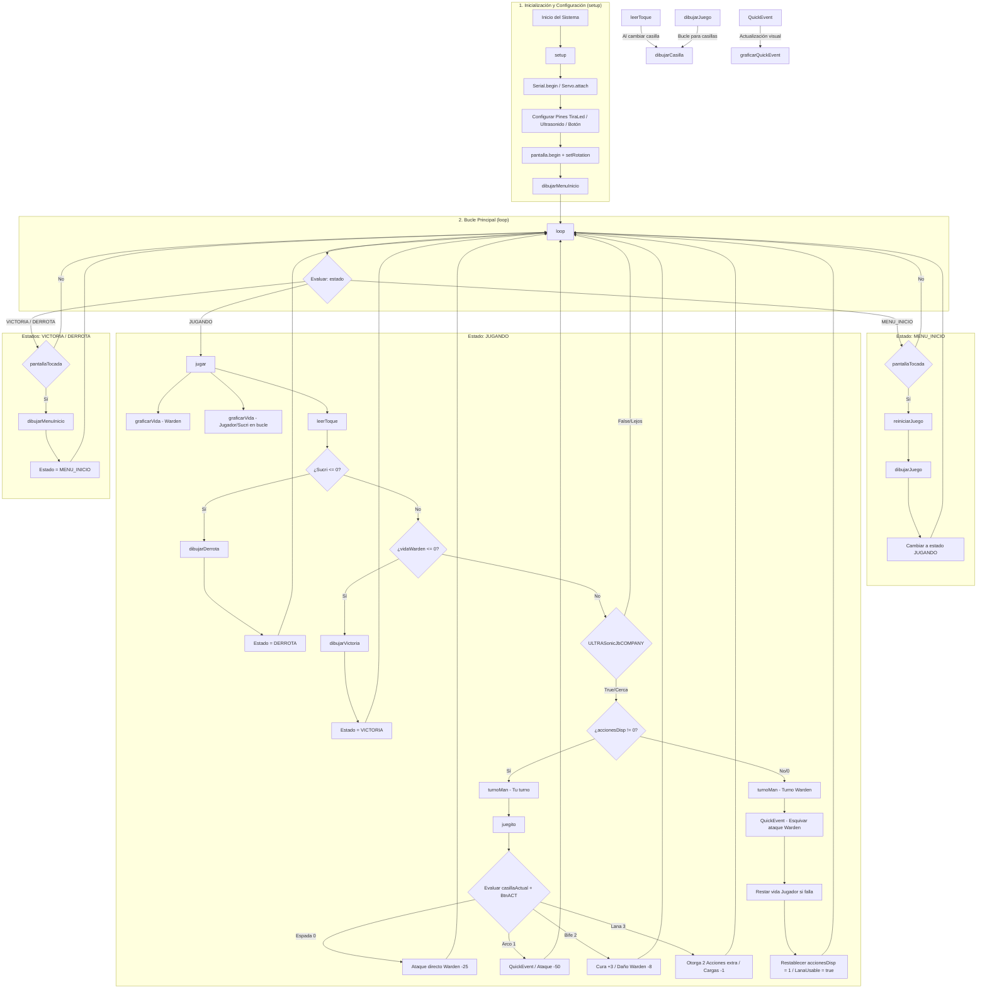

# Diagrama de Flujo Completo y Guía de Funciones ("Warden Game")

Este documento contiene la explicación exhaustiva de **cada función existente en el proyecto**, organizada por módulo, junto con un **diagrama de flujo unificado** que muestra exactamente cómo interactúan y se invocan entre sí durante la ejecución del programa.

---

## 1. Diagrama de Flujo de Ejecución y Funciones

---

## 2. Diccionario de Funciones y Módulos

### A. Módulo Principal (`Amigochis.ino`)

| Función | Tipo / Retorno | Descripción Detallada | Invocada por | Invocaciones directas |
| :--- | :--- | :--- | :--- | :--- |
| `setup()` | `void` | Inicializa puerto Serial, asigna el pin del servo motor (`BerlinSans`), declara salidas para la tira LED, detecta/inicializa la pantalla TFT con `MCUFRIEND_kbv` y muestra el menú inicial. | Sistema Arduino | `Serial.begin()`, `Servo.attach()`, `pinMode()`, `pantalla.begin()`, `dibujarMenuInicio()` |
| `loop()` | `void` | Máquina de estados principal. Según la variable `estado`, conmuta la ejecución entre el menú, la jugabilidad interactiva o las pantallas finales. | Sistema Arduino | `pantallaTocada()`, `reiniciarJuego()`, `dibujarJuego()`, `jugar()`, `dibujarMenuInicio()` |
| `jugar()` | `void` | **Corazón del flujo de partida.** Dibuja las barras de vida actualizadas, gestiona entradas táctiles, valida condiciones de victoria/derrota e intercambia turnos entre Jugador y Warden usando el sensor de proximidad. | `loop()` | `graficarVida()`, `leerToque()`, `dibujarDerrota()`, `dibujarVictoria()`, `ULTRASonicJbCOMPANY()`, `juegito()`, `turnoMan()`, `QuickEvent()` |
| `ULTRASonicJbCOMPANY()` | `bool` | Mide la distancia con el sensor HC-SR04 (`gustavo`). Si el jugador está a menos de 5 cm, habilita el turno activo y ajusta el servo en 90°; de lo contrario, posiciona el servo en 0°. | `jugar()` | `gustavo.read()`, `BerlinSans.write()` |

---

### B. Módulo de Interfaz y Pantalla (`pantalla.h` / `pantalla.cpp`)

| Función | Tipo / Retorno | Descripción Detallada | Invocada por | Invocaciones directas |
| :--- | :--- | :--- | :--- | :--- |
| `textoCentrado()` | `void` | Calcula la anchura en píxeles de una cadena de texto según su tamaño de fuente y la imprime centrada horizontalmente en el eje $X$ ($480\text{ px}$). | Funciones de menú | `pantalla.setTextSize()`, `pantalla.setCursor()`, `pantalla.print()` |
| `pantallaTocada()` | `bool` | Lee la presión instantánea del digitalizador táctil (`TouchScreen`). Restaura los pines analógicos compartidos (`XM`, `YP`) y devuelve `true` si la lectura $Z$ está dentro del rango válido ($10 < Z < 1000$). | `loop()` | `tactil.getPoint()`, `pinMode()` |
| `dibujarJuego()` | `void` | Limpia la pantalla con el color de fondo y dibuja la interfaz de la *hotbar* de 4 casilla mediante un bucle. | `loop()` | `pantalla.fillScreen()`, `dibujarCasilla()` |
| `dibujarMenuInicio()`| `void` | Pinta el fondo del menú principal, muestra el título del juego ("Warden"), el subtítulo y posiciona el servo a 90°. | `setup()`, `loop()` | `pantalla.fillScreen()`, `textoCentrado()`, `BerlinSans.write()` |
| `dibujarVictoria()` | `void` | Despliega la pantalla de victoria sobre fondo verde brillante y ajusta el servo motor a 0°. | `jugar()` | `pantalla.fillScreen()`, `textoCentrado()`, `BerlinSans.write()` |
| `dibujarDerrota()` | `void` | Renderiza la pantalla de derrota sobre fondo rojo indicando que la partida terminó. | `jugar()` | `pantalla.fillScreen()`, `textoCentrado()` |
| `leerToque()` | `void` | Procesa la pulsación táctil sobre la barra de acceso rápido (*Hotbar*). Mapea coordenadas del digitalizador a píxeles, detecta la casilla presionada, re-dibuja el marco de selección y notifica la selección por Serial. | `jugar()` | `tactil.getPoint()`, `map()`, `dibujarCasilla()`, `Serial.println()` |
| `dibujarCasilla()` | `void` | Dibuja una casilla individual de la *Hotbar* ($80 \times 80\text{ px}$) con sombras 3D. Muestra el número de lanas restantes si es la casilla 2 e incluye un marco blanco si la casilla está activa. | `dibujarJuego()`, `leerToque()` | `pantalla.fillRect()`, `pantalla.drawRect()`, `pantalla.print()` |
| `graficarQuickEvent()`| `void` | Renderiza en tiempo real el minijuego de reacción: dibuja la barra base, la línea objetivo dinámicamente y la aguja móvil según el tiempo transcurrido. | `QuickEvent()` | `pantalla.fillRect()` |
| `graficarVida()` | `void` | Dibuja un marco rectangular con relleno proporcional al porcentaje de salud restante (para la vida del Warden o las barras de vida del jugador). | `jugar()` | `pantalla.drawRect()`, `pantalla.fillRect()`, `map()`, `constrain()` |
| `turnoMan()` | `void` | Muestra en la cabecera de la pantalla de quién es el turno actual ("Tu turno" o "Turno del warden"). | `juegito()`, `jugar()` | `pantalla.fillRect()`, `pantalla.print()` |

---

### C. Módulo de Lógica de Juego (`juego.h` / `juego.cpp`)

| Función | Tipo / Retorno | Descripción Detallada | Invocada por | Invocaciones directas |
| :--- | :--- | :--- | :--- | :--- |
| `QuickEvent()` | `bool` | Minijuego de precisión por tiempo dinámico. Genera una posición objetivo aleatoria, ejecuta un bucle midiendo milisegundos transcurridos con `millis()`, evalúa el acierto con `BtnACT()` y calcula el daño infligido. Devuelve `true` si fue exitoso. | `juegito()`, `jugar()` | `graficarQuickEvent()`, `BtnACT()`, `pantalla.fillRect()` |
| `BtnACT()` | `bool` | Realiza el *debouncing* (anti-rebote) básico por software del botón físico `BTN1`. Devuelve `true` solo una vez en el instante de flanco de subida cuando se presiona la tecla. | `QuickEvent()`, `juegito()` | `digitalRead()` |
| `juegito()` | `void` | **Gestor de habilidades.** Evalúa la casilla activa seleccionada por el usuario al presionar el botón de acción:  • **0 (Espada):** -25 HP al Warden. • **1 (Arco):** Dispara `QuickEvent()`, si acierta hace -50 HP. • **2 (Bife):** Sana +3 Sucri, resta -8 HP al Warden. • **3 (Lana):** Otorga 2 acciones a cambio de 1 lana. | `jugar()` | `BerlinSans.write()`, `digitalWrite()`, `QuickEvent()`, `Serial.println()` |
| `reiniciarJuego()` | `void` | Restablece las variables globales a sus valores iniciales para empezar una nueva partida (Vida Warden = 250, Salud Jugador = 20, Lanas = 3, Acciones = 1, etc.). | `loop()` | Ninguna (Asignaciones directas) |

---

## 3. Guía de Flujo Completo (Paso a Paso)

1. **Encendido:** `setup()` configura el hardware, borra la pantalla e invoca `dibujarMenuInicio()`.
2. **Esperando inicio:** `loop()` se mantiene en `MENU_INICIO` hasta que `pantallaTocada()` retorna `true`.
3. **Inicio de Partida:** Se ejecuta `reiniciarJuego()`, se conmuta el estado a `JUGANDO` y `dibujarJuego()` dibuja la *Hotbar*.
4. **Ciclo de Turno (Jugador):**
   * `jugar()` redibuja las barras de salud con `graficarVida()`.
   * `leerToque()` escucha si el usuario cambia el ítem en la interfaz.
   * `ULTRASonicJbCOMPANY()` verifica proximidad física. Si es correcto y hay acciones disponibles (`accionesDisp != 0`), llama a `juegito()`.
   * Al pulsar el botón físico, `juegito()` evalúa el ítem equipado y aplica daño o curación.
5. **Ciclo de Turno (Warden / Enemigo):**
   * Cuando `accionesDisp == 0`, `jugar()` inicia la fase defensiva.
   * Se llama a `QuickEvent()`. Si el jugador **falla**, el Warden resta salud (`Sucri -= 8`).
   * Se recargan las acciones (`accionesDisp = 1`) y regresa el turno al jugador.
6. **Resolución:**
   * Si `vidaDelMalditoYHorribleWarden <= 0`, `jugar()` invoca `dibujarVictoria()`.
   * Si `Sucri <= 0`, `jugar()` invoca `dibujarDerrota()`.
   * Cualquier toque en pantalla regresa el flujo al `MENU_INICIO`.
#  Minijuego: Batalla contra el Warden en la Ciudad Antigua
**Proyecto Final 2026 - Grupo 07 (2026/2tg07)**

> Una experiencia interactiva e inmersiva que recrea una "Ancient City" de Minecraft mediante Arduino. Sobreviví y derrotá al Warden en este juego electrónico por turnos.

---

##  Descripción del Proyecto

El proyecto consiste en una maqueta interactiva que simula las imponentes estructuras subterráneas de ladrillo de pizarra profunda y el *sculk* de Minecraft. El sistema funciona como un mini-juego estratégico por turnos donde el jugador debe enfrentarse al Warden. 

Mediante el uso de luces LED, sonido y sensores, la maqueta brinda una experiencia envolvente. Además, el diseño del circuito integra una placa Arduino, llaves, módulos y programación que cumplen con los requisitos obligatorios de Taller.

##  Mecánicas del Juego

El combate es táctico y por turnos. El jugador dispone de **1 acción por turno** y tiene 4 opciones en su inventario para intentar vencer al Warden:

1.  **Espada:** Quita un 10% de la vida del Warden.
2.  **ARCO** Quita en 20/% requiere precisión. 
3.  **Carne:** Restaura **1.5 corazones** de la vida del jugador.
4.  **Lanas (x3 usos en total):** Permite amortiguar el sonido. le otorga al jugador **2 acciones** consecutivas.

##  Tecnologías y Componentes

El circuito está diseñado con componentes de Taller de Tecnologías de Base para cumplir con la implementación obligatoria de al menos un sensor y un motor:

###  Electrónica (Hardware)
* 1x Arduino UNO
* 1x Arduino NANO
* 1x Sensor de Ultrasonido (Cumple requisito de sensor)
* 1x Servomotor (Cumple requisito de motor)
* 1x Placa Driver
* 1x Buzzer
* LEDs (Azules y Rojos)
* Tiras LED de 12V
* A + (numero de acciones)
* Cl + (cantidad de lanas) / Cln (si no hay lanas)
* V0 (temoriste)
* ganastebro (bue si)

https://www.tinkercad.com/things/emPoVc5K16y-grand-elzing/edit?returnTo=https%3A%2F%2Fwww.tinkercad.com%2Fdashboard
