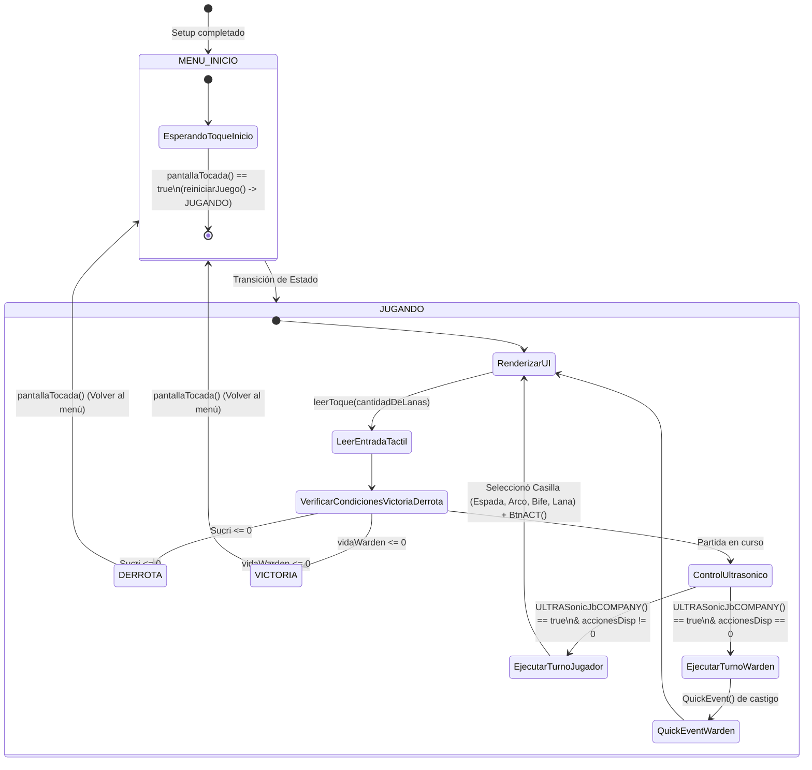

# Diagrama de Arquitectura y Funcionamiento del Sistema ("Warden Game")

Este documento detalla el flujo de ejecución, la máquina de estados, la interacción de módulos y una serie de **trucos avanzados** para seguir mejorando y escalando tu código en Arduino Mega.

---

## 1. Diagrama de Flujo del Sistema (Máquina de Estados)



---

## 2. Desglose de Módulos y Componentes

### A. Módulo de Pantalla (`pantalla.h` / `pantalla.cpp`)
*   **Gestión Gráfica:** Utiliza `MCUFRIEND_kbv` y `Adafruit_GFX`. Renderiza botones estilo barra inferior (*Hotbar*) con efectos 3D simulados mediante sombras y bordes.
*   **Gestión Táctil:** `leerToque()` traduce los puntos crudos del sensor resistivo (`TouchScreen`) a coordenadas de píxeles reales de la pantalla ($480 \times 320$) mediante la función `map()`.
*   **Feedback Visual:** Contiene funciones para renderizar barras de vida dinámicas (`graficarVida`), eventos de tiempo rápido (`graficarQuickEvent`) y textos centrados responsivos.

### B. Módulo de Juego (`juego.h` / `juego.cpp`)
*   **Lógica de Acciones (`juegito`):**
    *   *Casilla 0 (Espada):* Ataque directo al Warden, consume acción y enciende LED.
    *   *Casilla 1 (Arco):* Lanza el minijuego de precisión `QuickEvent()`.
    *   *Casilla 2 (Bife):* Cura al jugador (`Sucri += 3`) pero daña levemente al Warden.
    *   *Casilla 3 (Lana):* Habilidad especial con cargas limitadas que otorga doble acción.
*   **Minijuego de Precisión (`QuickEvent`):** Controla el tiempo transcurrido mediante `millis()`, dibujando una barra de progreso en tiempo real y evaluando si el botón `BTN1` fue presionado en el rango de tolerancia exacto.

### C. Sketch Principal (`.ino`)
*   **Sensores Periféricos:** Integra un sensor ultrasónico (`Ultrasonic gustavo`) para detectar la presencia o proximidad del jugador y activar el turno.
*   **Actuadores:** Servo motor `BerlinSans` conectado en el pin `44` para indicar estados visuales físicos y tira de LEDs en pines digitales.

---

## 3. Trucos y Recomendaciones para Seguir Implementando

### 1. Optimización de Memoria RAM (Uso de `F()`)
Dado que Arduino Mega tiene memoria limitada, los literales de texto largos dentro de `Serial.println()` o `pantalla.print()` consumen valiosa memoria dinámica.
*   **Truco:** Envuelve los textos estáticos con la macro `F()`.
    ```cpp
    // Antes:
    Serial.println("Casilla seleccionada: ");
    // Después:
    Serial.println(F("Casilla seleccionada: "));
    ```

### 2. Eliminación de Bloqueos (`delay` por `millis`)
El uso frecuente de `delay(300)` detiene por completo la ejecución del microcontrolador, lo que puede causar que el usuario toque la pantalla y no se registre.
*   **Truco:** Implementa una máquina de estados temporizada basada en `millis()` para las pausas de transición, permitiendo que el sensor táctil siga respondiendo fluidamente.

### 3. Calibración Dinámica del Táctil
Los touchscreens resistivos baratos suelen descalibrarse con el uso o los cambios térmicos.
*   **Truco:** Añade una rutina de calibración inicial guardando los valores mínimos y máximos en la memoria **EEPROM** del Arduino Mega la primera vez que se enciende el dispositivo.

### 4. Modularización de Sonido o Efectos
*   **Truco:** Puedes agregar un buzzer pasivo utilizando la librería `tone()` sincronizada con los eventos del `QuickEvent` o cuando el jugador acierta un ataque crítico con la espada, mejorando drásticamente el "Game Feel".

### 5. Escalabilidad de Ítems (Hotbar Dinámica)
Actualmente el arreglo `objectos[4]` tiene un tamaño fijo.
*   **Truco:** Convierte el inventario en una estructura de datos (struct) que permita agregar nuevos ítems, durabilidad de armas o efectos especiales sin modificar toda la lógica de renderizado:
    ```cpp
    struct Item {
      String nombre;
      int daño;
      int consumoMana;
      uint16_t colorTema;
    };
    ```